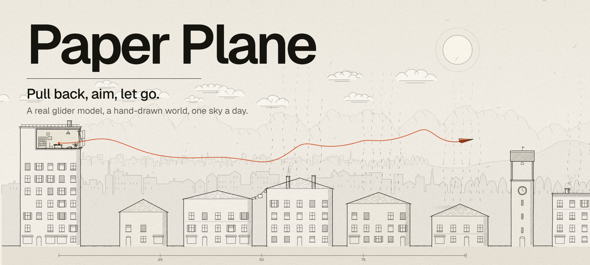
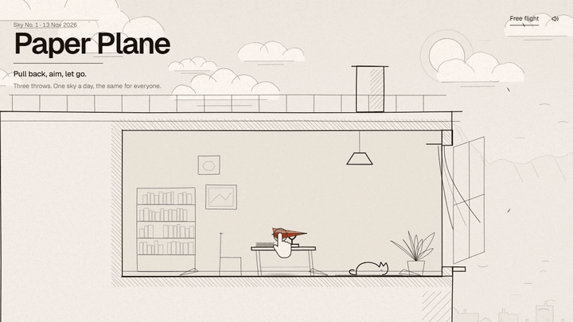
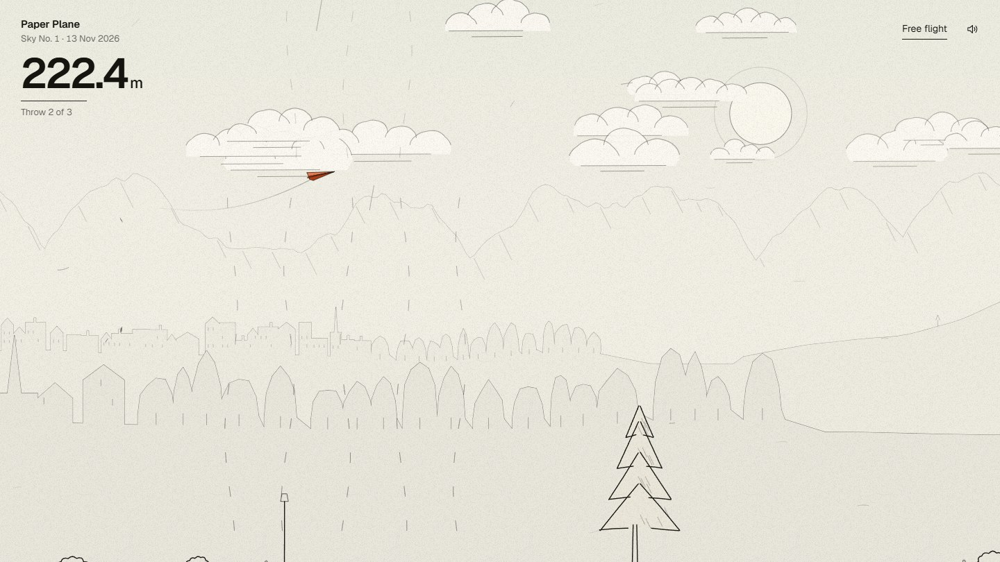
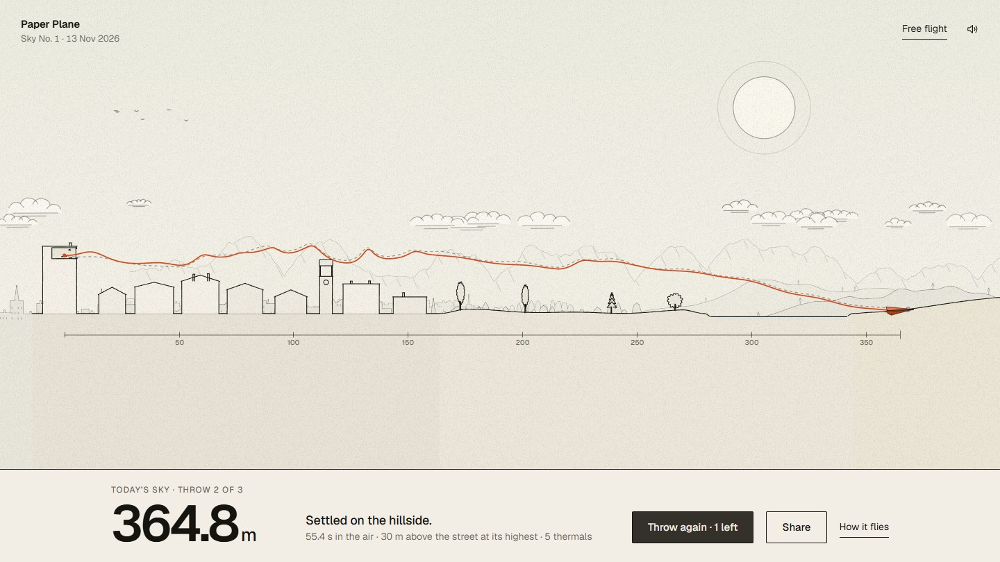
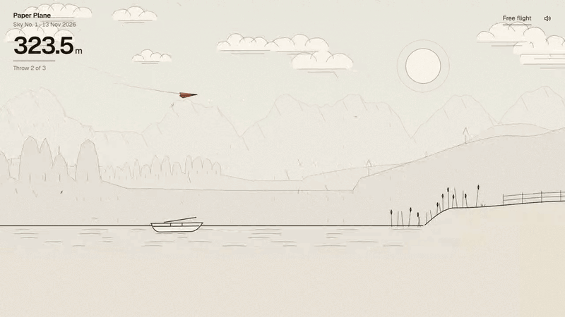
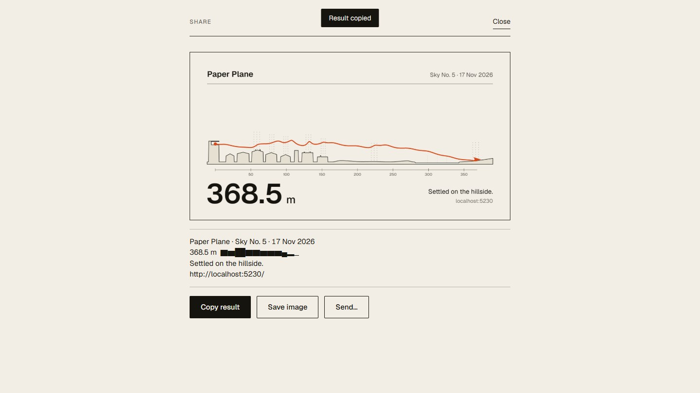
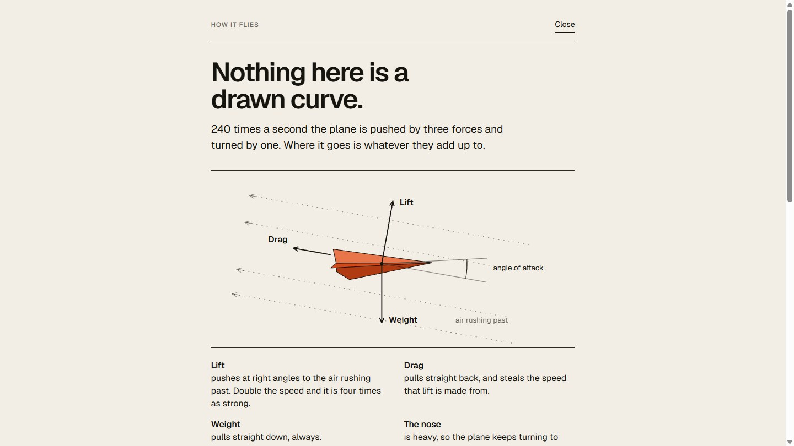
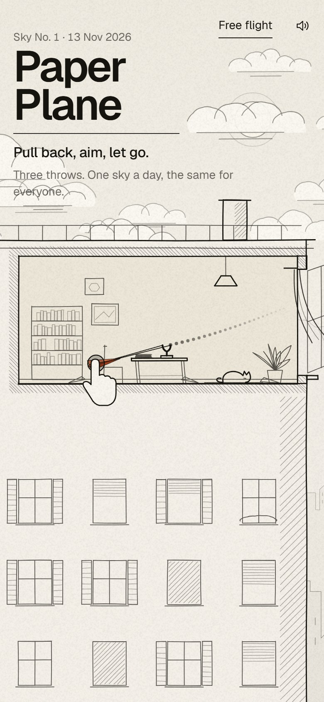
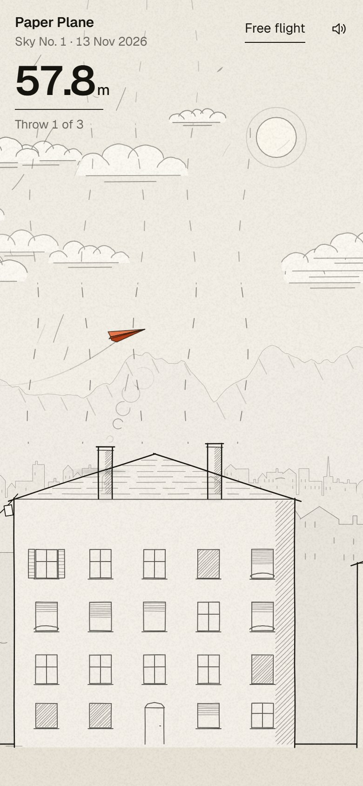
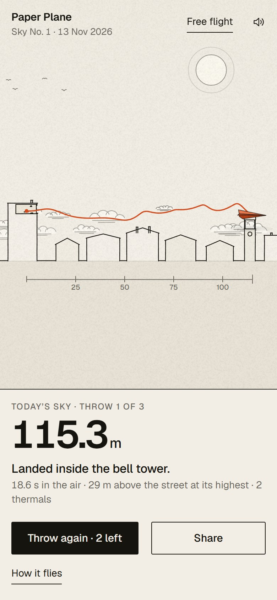

<a href="https://pratyushshivam.github.io/paper-plane/"></a>

<p align="center">
  <a href="https://pratyushshivam.github.io/paper-plane/"></a>
  <a href="https://github.com/pratyushshivam/paper-plane/actions/workflows/ci.yml"></a>
  <a href="LICENSE"></a>
  
</p>

<p align="center">
  <a href="https://pratyushshivam.github.io/paper-plane/"><b>Play it</b></a> ·
  <a href="#how-to-play">How to play</a> ·
  <a href="#the-flight-model">The flight model</a> ·
  <a href="#how-it-works">How it works</a> ·
  <a href="#run-it">Run it</a> ·
  <a href="https://www.pratyushshivam.com/">pratyushshivam.com</a>
</p>

# Paper Plane

**Pull back, aim, let go. See how far today's sky carries it.**

A paper plane, a top-floor window and a long hand-drawn world: over the rooftops, across a park, a river, and into the hills. One gesture throws it. After that the air decides. Wind, warm air rising off sunny roofs, cold air sinking over the water, washing lines and trees in the way.

There is one sky a day and it is the same for everyone, so a distance means something. You get three throws and the best one counts.

**Play:** [pratyushshivam.github.io/paper-plane](https://pratyushshivam.github.io/paper-plane/)

<a href="https://pratyushshivam.github.io/paper-plane/"></a>

<p align="center"><sub>One throw, recorded from the running page at real speed. The hand at the start is the game teaching the gesture; the throw after it is a real mouse drag.</sub></p>

There is no account, no server and no tracking. It is one static page, and once it has loaded it never talks to the network again.

<table>
<tr>
<td width="50%" valign="top"><br><sub><b>The start.</b> Nobody reads anything. A hand shows the gesture once, and the dotted arc is the first moment of the real flight.</sub></td>
<td width="50%" valign="top"><br><sub><b>Over the town.</b> The climbing dashes are warm air. Fly through them.</sub></td>
</tr>
<tr>
<td width="50%" valign="top"><br><sub><b>Over the park.</b> Three layers of distance behind the world, and clouds that drift with the day's wind.</sub></td>
<td width="50%" valign="top"><br><sub><b>After a throw.</b> The flight you just made, drawn over your best one so far.</sub></td>
</tr>
</table>

| | |
| :-- | :-- |
| **A round** | Three throws. The best one counts |
| **The goal** | Distance, in metres, from the hand to wherever the plane stops |
| **Daily sky** | Wind, thermals and obstacles come from the date, so everyone flies the same day and can compare |
| **Controls** | One gesture to throw, and one hold in the air. Mouse, touch, or Space on a keyboard |
| **Stack** | TypeScript, Vite, one canvas, WebAudio. A pure TypeScript engine with tests. Nothing else |

## How to play

1. **Press, pull back, let go.** How far you pull is how hard it is thrown. Which way you pull is where it points. A short pull will not clear the room.
2. **Hold to lift the nose.** That is the only control in the air. The plane slows down and sinks a little less: good inside rising air, bad into a headwind, and a stall if you hold it with no speed left.
3. **Read the air.** Climbing dashes are warm air going up. Falling dashes over the river are cold air going down. Thin streaks and leaves show which way the wind is blowing and how hard.
4. **Three throws.** After each one the flight is drawn over the world, with your best so far as a dashed line next to it.

<a href="https://pratyushshivam.github.io/paper-plane/"></a>

<p align="center"><sub>The end of a 370 metre flight on the sky of 17 November 2026, recorded from the running page.</sub></p>

How a flight ends depends on how it comes down. Flat and it skids. Steep and it digs its nose in and flips. It can wedge in a tree, hang on a washing line, crumple against a wall and flutter down, or land in the river.

## Things to play with

- **Today's sky** is the same for everyone in the world with the same date, and changes at midnight.
- **Free flight** swaps it for a random sky nobody else has seen.
- **Throw it at the ceiling.** It stalls and lands at your feet. That is the model, not a rule.
- **Throw it hard and level.** It climbs, slows, dips and climbs again. Nothing tells it to swoop.
- **Share.** The page copies a short result and draws a picture of the flight over the land it crossed.

<table>
<tr>
<td width="42%" valign="top"></td>
<td width="58%" valign="top">

**The result** is four lines of text, with the height of the flight as a row of bars:

```
Paper Plane · Sky No. 1 · 13 Nov 2026
146.2 m  ██▅▇▇▅▆▅▄▃▂▁
Caught on a washing line.
```

**The card** is drawn on a canvas in your browser. On a phone it goes to the system share sheet through the Web Share API. Elsewhere it is saved as a PNG. Nothing is uploaded.

</td>
</tr>
</table>

## The flight model

Nothing in the flight is a drawn curve. The plane is a point with a pitch angle, and 240 times a second three forces push it and one turns it.

| Part | What the game does | Where |
| :-- | :-- | :-- |
| **Lift and drag** | Both come from the angle of attack, the angle between the wing and the air moving past it, and both grow with the square of the speed. Lift acts at right angles to the airflow, drag along it | [`glider.ts`](src/engine/glider.ts) |
| **Stall** | Past about 13 degrees the model blends from a lifting wing to a flat plate: lift drops, drag jumps, and the plane falls until it has the speed to fly again | [`glider.ts`](src/engine/glider.ts) |
| **Pitch** | Its own equation. The nose is heavy, so the plane keeps turning to meet the air at its trim angle, about 5.5 degrees, with damping. Holding the screen raises that angle by about 4 degrees | [`flight.ts`](src/engine/flight.ts) |
| **The air** | Every force uses the plane's velocity through the air, and the air moves: wind that is slower near the ground and gusts over time, thermals with a soft edge and a ceiling, sink over the river, lift where wind meets a rising slope and sink in its lee | [`air.ts`](src/engine/air.ts) |
| **Ground effect** | Within about half a metre of a surface the drag that comes with lift fades, so a low plane floats further than you expect | [`glider.ts`](src/engine/glider.ts) |
| **Landings** | Skid, flip, tree, washing line, wall or river, decided by what was hit and how steeply | [`flight.ts`](src/engine/flight.ts) |
| **The world** | One seed builds the room, town, park, river and hills, and the day's wind. The daily seed is the date | [`world.ts`](src/engine/world.ts), [`daily.ts`](src/engine/daily.ts) |



<p align="center"><sub><b>How it flies</b> is one page inside the game, reachable from the end of any throw. Its lift and drag graph is plotted from the same functions the flight uses.</sub></p>

**The swoop is not scripted.** Throw the plane hard and it has more lift than weight, so it climbs, slows, noses over, speeds up and climbs again. That slow exchange of height and speed is called a phugoid, and it falls out of the equations on its own.

**It is deterministic.** The step is fixed, there is no randomness in flight, and the world comes from a seeded generator. The same throw into the same sky lands in the same place every time. That is what makes a daily sky fair, and it is why the aiming arc can be the first 0.6 seconds of the real flight instead of a guess.

**Skill is measurable.** [`scripts/pilot.ts`](scripts/pilot.ts) flies each day with a look-ahead autopilot and compares it with letting go and watching. On the first six daily skies the best hands-off throw reaches 128 to 417 metres and the pilot reaches 205 to 527. On the very first sky that is 155 metres against 326.

**The numbers.** It trims at 6.5 m/s and glides 7.4 metres forward for each metre down. With the nose held up it slows to 4.9 m/s.

## On a phone

<table>
<tr>
<td width="33%" valign="top"></td>
<td width="33%" valign="top"></td>
<td width="33%" valign="top"></td>
</tr>
</table>

<p align="center"><sub>Pull with a thumb anywhere on the screen, hold anywhere to lift the nose. These three were captured at phone size in a desktop browser.</sub></p>

## How it works

**The simulation and the picture are separate.** The engine steps at a fixed 240 times a second whatever the screen is doing, and the drawing interpolates between steps. The engine has no DOM in it, so the same code runs in the page, in the tests and in the scripts that tune it.

**Every line is drawn by the same pen.** A handful of functions make strokes that wobble, bow and overshoot a little. Each building, tree and the room is drawn once per sky into cached paths, in metres, and the camera is only a transform. That is why the close view of the room and the map of a whole flight are the same drawing.

**The camera does a lot of the work.** It leads the plane, pulls back as it climbs so the ground stays in view, closes in for the landing, and then fits the whole flight above the end card. On a narrow screen a long flight is travelled along instead of shrunk.

**Sound is made on the spot** with WebAudio from noise and sine waves: air rush that follows speed, a soft chord inside rising air, a flutter in a stall, paper on landing. There are no audio files. The mute button is remembered.

**What is kept** is your best distance, today's best flight and the mute setting, in this browser's local storage and nowhere else.

```
src/engine   the model: the world from a seed, the air, lift and drag, the flight step,
             landings, the daily seed. No page in it. Tested.
src/render   the canvas: pen strokes, scenery, sky and parallax, plane, shadow, trail
src/main.ts  the game: aiming, the flight loop, landings, the camera, the end card
src/audio.ts sound, generated
src/share.ts the text result and the picture card
tests        24 tests over everything in src/engine
```

The page is about 29 kB of script compressed, one font file and an icon. It held 60 frames a second at phone and laptop sizes on the laptop it was built on.

## What is simplified

- **It glides too well.** A real sheet of A4 manages about 4 metres forward for each metre down. This one manages 7.4, so that a throw from a top-floor window is a journey and not a few seconds.
- **It is flat.** The world is a side-on slice. There is no turning, no rolling and no crosswind. The banking you see is drawn, not simulated.
- **The plane is a point.** Lift, drag and the turning of the nose are lumped into a few coefficients. There is no flexing paper and no separate tail.
- **The air is tidy.** Thermals are smooth columns that stand still, and gusts are slow waves. Real air is messier and nobody can see it.
- **The metres are generous.** The plane is drawn larger than life so that it can be seen, and the ground effect reaches higher than it would for a wing that small.

## Run it

Needs Node.js 20 or newer.

```bash
npm install
```

```bash
npm run dev
```

Then open `http://localhost:5230`.

| Command | What it does |
| :-- | :-- |
| `npm run dev` | Development server |
| `npm run build` | Type check, then a static build in `dist/`, ready for any static host |
| `npm test` | The tests for the engine |
| `npm run typecheck` | TypeScript, no emit |
| `npm run tune` | Fly a grid of throws over several skies and print how far each goes |
| `npx tsx scripts/pilot.ts 14` | How much a careful pilot gains over a hands-off throw, day by day |

The build uses relative paths, so the same `dist/` works at a domain root or in a sub-folder.

Every picture and recording on this page was captured from the running page. The banner and the social card are drawn by [`scripts/banner.html`](scripts/banner.html) with the game's own renderer; the flight in them is a real one, on the sky of 17 November 2026.

## Licence

[MIT](LICENSE). The typeface is Geist, used under the SIL Open Font License.

<p align="center"><sub>Built by <a href="https://www.pratyushshivam.com/">Pratyush Shivam</a>.</sub></p>
