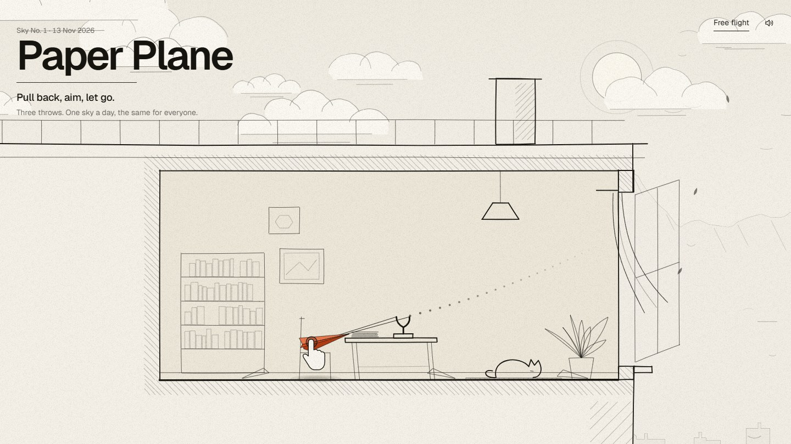
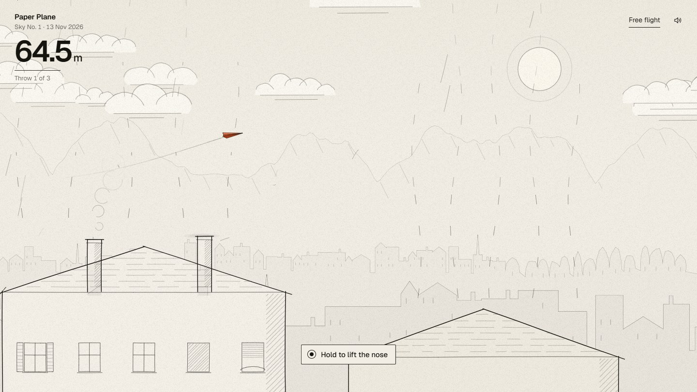
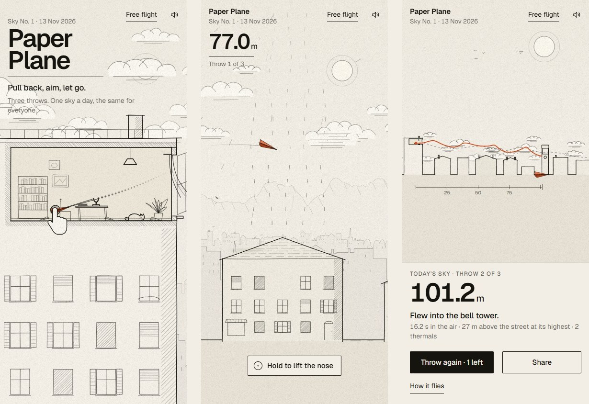

# Paper Plane

**Pull back, aim, let go. See how far today's sky carries it.**

A paper plane, a top-floor window and a long hand-drawn world: over the rooftops, across a park, a river, and into the hills. One gesture throws it. After that the air decides: wind, columns of warm air over sunny roofs, cold sinking air over the water, washing lines and trees in the way.

There is one sky a day and it is the same for everyone, so a distance means something. You get three throws; the best one counts.

No account, no server, no tracking, nothing to download. It is one static page, and after it loads it never talks to the network again.

<table>
<tr>
<td width="50%" valign="top"><br><sub><b>Over the town.</b> The rising dashes are warm air. Fly through them.</sub></td>
<td width="50%" valign="top"><br><sub><b>After a throw.</b> The flight you just made, over your best one so far.</sub></td>
</tr>
<tr>
<td width="50%" valign="top"><br><sub><b>Over the park.</b> Three layers of distance behind the world, and clouds that drift with the day's wind.</sub></td>
<td width="50%" valign="top"><br><sub><b>How it flies.</b> One page, two diagrams, plain words.</sub></td>
</tr>
</table>



## How to play

1. **Press, pull back, let go.** How far you pull is how hard it is thrown. Which way you pull is where it points. A dotted arc shows the first moment of the flight before you commit.
2. **Hold to lift the nose.** That is the only control in the air. The plane slows down and sinks a little less: good inside rising air, bad into a headwind, and a stall if you hold it with no speed left. On a keyboard, hold Space.
3. **Three throws. The best one counts.** After each throw the flight is drawn over the world, with your best attempt as a dashed line next to it.

**Share** copies a short result and makes a picture of the flight:

```
Paper Plane · Sky No. 1 · 13 Nov 2026
146.2 m  ██▅▇▇▅▆▅▄▃▂▁
Caught on a washing line.
```

**Free flight** swaps today's sky for a random one that nobody else has seen.

## The flight model

Nothing in the flight is a drawn curve. The plane is a point with a pitch angle, and 240 times a second three forces push it and one turns it.

**Lift and drag come from the angle of attack**, the angle between the wing and the air moving past it. Lift acts at right angles to that airflow and drag acts along it, and both grow with the square of the speed. Up to about 13 degrees, more angle means more lift. Past it the wing stalls: the model blends from a lifting wing to a flat plate, so lift drops, drag jumps, and the plane falls until it has the speed to fly again. A throw aimed at the ceiling ends on the floor for exactly that reason.

**Pitch is its own equation.** A paper plane is nose-heavy, so it keeps turning to meet the air at its trim angle, about 5.5 degrees, with some damping. Nothing tells the plane to swoop. Throw it hard and it has more lift than weight, so it climbs, slows, noses over, speeds up and climbs again. That slow exchange of height and speed is the phugoid, and it falls out of the equations on its own.

**The wing only feels the air it is in.** Every force is worked out from the plane's velocity relative to the air, and the air moves: a mean wind that is slower near the ground and gusts over time, thermals as columns with a soft edge and a ceiling, sinking air over the river, and ridge lift where the wind meets a rising slope (with matching sink in the lee). Within half a metre of a surface, ground effect cuts the drag that comes with lift, so a low plane floats further than you expect.

The numbers: it trims at 6.5 m/s and glides 7.4 metres forward for each metre down. A real sheet of A4 manages about 4 to 1, so this is a very well folded plane. With the nose held up it slows to 4.9 m/s.

**It is deterministic.** The step is fixed, there is no randomness in flight, and the world comes from one seeded generator keyed on the date. The same throw into the same sky lands in the same place every time, which is what makes a daily sky fair, and what lets the aiming arc be the first 0.6 seconds of the real flight rather than a guess.

**Skill is measurable.** `scripts/pilot.ts` flies each day with a look-ahead autopilot and compares it with letting go and watching. On the first six daily skies the best hands-off throw reaches 128 to 417 metres and the pilot reaches 205 to 527. On the very first sky that is 155 metres against 326.

## Run it

```bash
npm install
npm run dev        # http://localhost:5230
```

```bash
npm test           # 24 tests on the engine
npm run build      # type-check, then a static site in dist/
npm run preview    # serve the build at http://localhost:5231
```

```bash
npm run tune       # fly a grid of throws over several skies and print distances
npx tsx scripts/pilot.ts 14   # how much a careful pilot gains, day by day
```

## How it is built

TypeScript in strict mode, Vite, vitest. No runtime dependencies: the page is about 29 KB of JavaScript gzipped, one font file and an icon.

| | |
| :-- | :-- |
| `src/engine` | The simulation, with no DOM in it. `world.ts` builds the room, town, park, river and hills from a seed. `air.ts` is the wind field. `glider.ts` holds the lift, drag and stall curves. `flight.ts` steps a throw at 240 Hz and decides how it lands: a skid, a flip, a tree, a washing line, a wall, the river. |
| `src/render` | Canvas 2D. `ink.ts` is the pen: every line wobbles and overshoots a little. `scenery.ts` draws each building, tree and the room once into cached paths. `backdrop.ts` is the sky, sun, clouds and three parallax layers. `renderer.ts` puts the frame together, with the plane, its shadow and trail. |
| `src/main.ts` | The game: aiming, the flight loop, landings, the camera, the end card. |
| `src/audio.ts` | Sound made in WebAudio from noise and sine waves: air rush that follows speed, a soft chord in rising air, paper on landing. Nothing is sampled. |
| `src/share.ts` | The text result and the picture card. |
| `tests` | Same seed and throw give the same flight to the millimetre. Energy never rises in still air. A stalled throw falls short. A thermal adds distance, sinking air takes it away. The daily seed is fixed for a date. Each kind of landing happens when it should. |

The simulation runs at a fixed 240 steps a second whatever the screen does, and the drawing interpolates between steps. The world is drawn in metres with the camera as a transform, so the same cached paths serve the close view of the room and the map of a whole flight. The canvas is sharp on dense screens up to a pixel budget, and holds 60 frames a second at phone and laptop sizes in testing.

Type is [Geist](https://vercel.com/font), under the SIL Open Font Licence.

## Licence

MIT. See [LICENSE](LICENSE).
